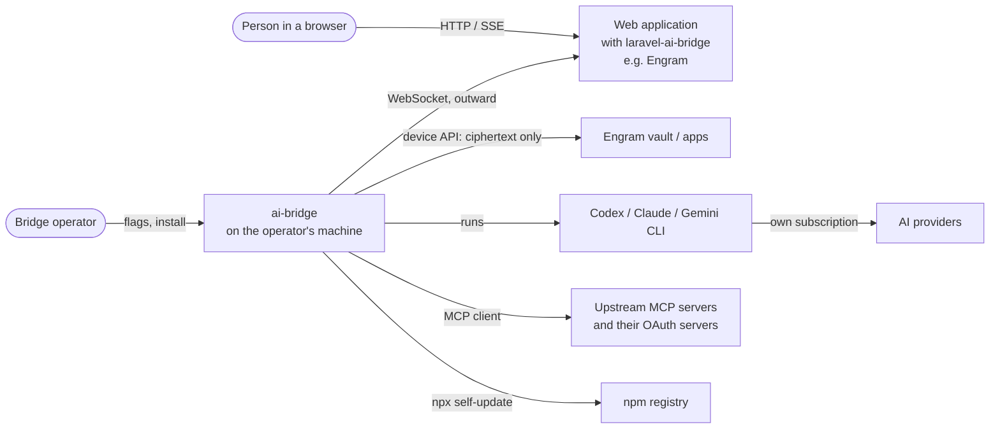

# Architecture

## Purpose

Let a web application use a person's own AI subscriptions. The bridge runs on
the person's machine, connects outward to the application's server over a
WebSocket, runs each AI turn through the locally installed Codex, Claude or
Gemini CLI, and streams normalized events back. The application never holds the
person's CLI credentials. Around that core the bridge also does work that has to
happen on the machine itself: running local tools and Engram app backends with
vault secrets decrypted there, keeping files, and connecting to MCP servers the
operator chose.

## Quality goals

1. **The operator's machine stays the operator's.** A server can ask; only the
   bridge operator's flags decide what a CLI or tool may touch
   ([isolation.md](isolation.md)). Secrets are opened and used here and never
   travel to the server.
2. **Installed bridges keep working.** Many bridges run unattended on machines
   nobody is watching; every protocol change is additive and the bridge updates
   itself to the version its server asks for.
3. **Failures are visible.** A refusal names its reason; nothing silently falls
   back to a different directory, posture or result that would read as success.
4. **Provider-agnostic output.** The server sees one streaming format whichever
   CLI answered.

## Context (C4 level 1)

The bridge always dials out, so it works behind NAT and firewalls. The person
and the bridge operator are often the same human, but the design treats them as
two parties.

## Containers (C4 level 2)

All on the operator's machine, inside or started by one Node process:

| Container | What it does | Code |
|---|---|---|
| Bridge process | WebSocket client, handshake, routing, turn lifecycle, self-update | `src/bridge.ts`, `src/selfupdate/` |
| CLI child processes | One spawn per turn, in a scratch directory or an allowed `working_dir`, with credentials stripped from the env | `src/providers/` |
| Bridge MCP server | HTTP MCP on `127.0.0.1`, per-spawn bearer token; exposes the server's tools, bridge tools and upstream tools to the CLI | `src/mcp/server.ts` |
| Upstream MCP clients | stdio or HTTP connections to operator-configured MCP servers, with OAuth | `src/mcp/upstream.ts`, `src/mcp/oauth.ts` |
| Local tool runs | Short-lived processes under `node --permission` and `unshare -rn`, vault values as env, output scrubbed | `src/local/` |
| App backend processes | One long-running process per Engram app version, Node permission model, network through the bridge's egress relay, code held to the version's own files (decision 0011) | `src/apps/` |
| Local stores | `~/.ai-bridge` (keys, OAuth tokens, apps), `~/.cache/ai-bridge` (attachments, session directories, update lock), allowed folders (uploads, space files) | `src/attachments/`, `src/workspace/`, `src/spacefiles/` |
| Service units | systemd user service or launch agent per installed bridge, pinned to a version | `src/service/` |

## Key concepts

- **Turn**: one `ai_request`, run as one CLI process, ending in `done`,
  `error` or `cancelled`. Bounded by silence rather than total duration.
- **Session id**: the CLI's own resumable session; the server stores it and
  sends it back (decision 0002).
- **Posture** (`cli_isolation`): `isolated`, `workspace` or `native`; what the
  server asked for, capped by the operator's flags (decision 0006).
- **Three kinds of tools**: server tools (run on the server via a socket
  round-trip), local tools (`execute: "local"`, run here with vault values,
  decision 0004) and upstream tools (from `--mcp-upstreams`, decision 0008).
- **Handshake capabilities**: `hello` fields that tell a server what this bridge
  understands; `welcome` fields that tell the bridge what the server wants
  (decision 0005).
- **Desired version**: `welcome.desired_bridge_version`, followed by managed
  bridges (decision 0007).
- **MCP Apps views**: UI a web application hosts for a tool call; the bridge
  only relays (decisions 0009, 0010).

## Risks and known limits

- An `isolated` Gemini turn is bounded only by Gemini's own defaults: there is
  no lever equivalent to Claude's permission mode or Codex's sandbox.
- User-level instruction files, skills, hooks and plugins still load for every
  provider; suppressing them would break subscription auth.
- Redaction is hygiene, not containment: a tool can encode a secret it was given.
- Self-update cannot recover from a release that crashes before reaching the
  update code; macOS and Windows do not update themselves.
- Upstream OAuth checks DNS before fetching and fetch resolves again, so a
  DNS-rebinding window remains.
- Provider CLIs and their terms change underneath the bridge; adapters track
  flags and output formats that are not stable APIs.
